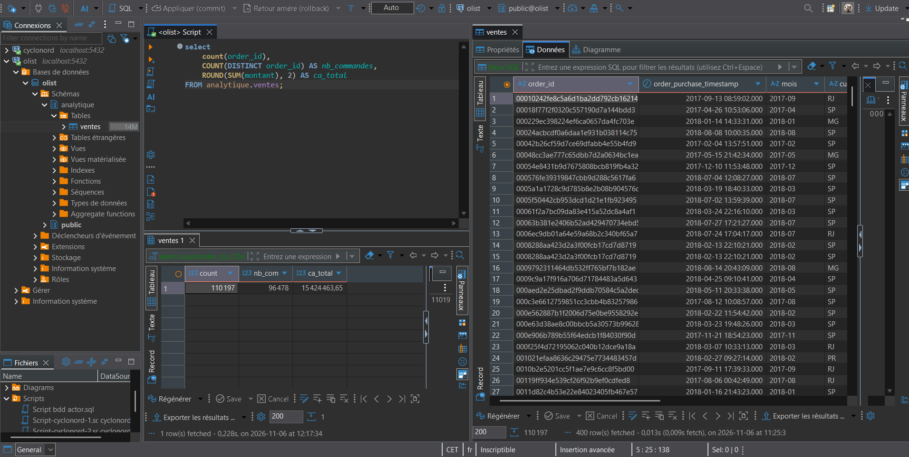

# Journal de l'API Olist — FastAPI

**Nom :** Frédéric Arnould
**Dates :** J1 05/11/2026 · J2 06/11/2026
**Fichier rendu :** api_olist_Frederic_ARNOULD.zip

> Compétences : WCS C1.6 · C2.4 · C2.1 · C2.5 (niveau 2 · Adapter) — Simplon C6 · C7 (partiel)
> Remplis les parties **dans l'ordre**. Remplace chaque « … ». Une phrase suffit sauf mention contraire.

**Chiffres de référence (export de lundi)**
- Lignes : 110 197 · Commandes livrées : 96 478
- CA total : 15 424 463,65 R$ · Panier moyen : 159,88 R$
- Novembre 2017 : 1 154 559,53 R$ et 7 289 commandes
- SP : 5 771 713,93 R$, 40 501 commandes, 37,42 % du CA

---

# J1 — L'API sur le fichier CSV

<a id="j-m1"></a>
## M1 — Lancer l'API et la tester

- Version de Python : Python 3.14.7
- Commande de lancement que j'ai utilisée : py -m uvicorn main:app --reload
- Code et `nb_lignes` renvoyés par `/sante` : code 200, {"statut":"ok","source":"csv","nb_lignes":110197}
- Différence entre `/docs` et `/sante` ouverts dans le navigateur : /docs est une interface graphique (Swagger) générée automatiquement par FastAPI pour tester les routes. /sante est une route API qui renvoie un JSON confirmant que l'API tourne.
- Problème rencontré et solution (ou « aucun ») : comprendre les consignes et ou/quand répondre aux questions

<a id="j-m2"></a>
## M2 — Lire une route complète

### Le trajet d'une requête `GET /indicateurs`, en 4 étapes

1. Le navigateur envoie une requête `GET` à l'adresse http://127.0.0.1:8000/indicateurs
2. FastAPI exécute la fonction indicateurs() du fichier main.py, qui appelle  `indicateurs()` de `donnees_csv.py`
3. Cette fonction lit `data/ventes_olist.csv` et renvoie un dictionnaire `{"nb_lignes": len(v),"nb_commandes": nb_commandes,"ca_total": round(ca_total, 2),"panier_moyen": round(ca_total / nb_commandes, 2),}`
4. Le modèle `class Indicateurs(BaseModel)` vérifie les champs et leurs types puis FastAPI renvoie un `JSON` avec le code `200`

### L'expérience du contrat

- Quand j'ai mis `panier_moyen` en commentaire dans le modèle, la réponse ne contient plus le champ `panier_moyen`.
- Conclusion : le modèle décide de ce qui sort, même si la fonction de données renvoie plus.

### Pourquoi deux fichiers (`main.py` et `donnees_csv.py`) ?

- `donnees_csv.py` **calcule** et ne sait rien du web. `main.py` **expose** et ne sait rien du calcul. Demain, tu remplaceras `donnees_csv.py` par `donnees_pg.py`, et `main.py` ne changera presque pas. C'est ce qu'on appelle un code **organisé**

### Comparaison avec lundi

- `nb_commandes` : 96478 (lundi : 96 478)
- `ca_total` : 15424463.65 (lundi : 15 424 463,65)

<a id="j-m3"></a>
## M3 — Ventes mensuelles

### Tests

- Sans paramètre : `23` mois, du `2016-09` au `2018-08`
- `debut=2017-01` et `fin=2017-12` : 12 mois ; novembre 2017 = `1154559.53` R$ et `7289` commandes
- `debut=2018-02` et `fin=2017-01` : code `400` , message `{"detail":"« debut » doit être antérieur ou égal à « fin »."}`
- `debut=2017-13` : code `422`

### Questions

1. Différence entre un paramètre de chemin et un paramètre de requête, avec un exemple de cette API : **Un paramètre de chemin fait partie de l’URL, par exemple `SP` dans `/etats/SP`. Un paramètre de requête suit le `?` et précise la demande, par exemple `debut=2017-01` dans `/ventes/mensuelles?debut=2017-01`.**
2. Qui renvoie le code 400 (toi ou FastAPI) ? Et le code 422 ? Pourquoi cette différence ? **Le code 400 est renvoyé par notre code quand la période est incohérente, par exemple si `debut` est après `fin`. Le code 422 est renvoyé automatiquement par FastAPI si un paramètre ne respecte pas le format déclaré, comme `debut=2017-13`.**

<a id="j-m4"></a>
## M4 — Top catégories

### Tests

- Sans paramètre : `10` catégories ; la première est `health_beauty` avec `9.16 %`
- Somme des 10 parts : `62.32 %`
- `n=3` : `25.3 %`
- `n=0` : code `422` · `n=51` : code `422`

### Question

- Que reçoit Rafael s'il n'envoie pas `n` ? Où est-ce décidé dans le code ? S'il n'envoie pas de valeur pour `n`, il reçoit les 10 catégories au plus fort chiffre d'affaires. La valeur par défaut `10` est définie dans `main.py`, dans le paramètre `Query(10, ...)` de la route `/categories/top`.

```python
def top_categories(n: int = Query(10, ge=1, le=50, description="Nombre de catégories (1 à 50)")):
    """Les n catégories au plus fort chiffre d'affaires."""
    return donnees.top_categories(n)`
```
<a id="j-m5"></a>
## M5 — Chiffres d'un État

### Mon modèle `Etat` (copie le code)

- Dans `main.py`
```python
class Etat(BaseModel):
    etat: str
    ca: float
    nb_commandes: int
    part_ca: float

@app.get("/etats/{code_etat}", response_model=Etat, tags=["Indicateurs"])
def etat(code_etat: str = Path(pattern=r"^[A-Za-z]{2}$", description="Code de l'État sur 2 lettres, ex. SP")):
    """Chiffres d'un État brésilien."""
    code = code_etat.upper()          # « sp » et « SP » donnent le même résultat
    resultat = donnees.etat(code)
    if resultat is None:
        raise HTTPException(status_code=404, detail=f"Aucune vente pour l'État « {code} ».")
    return resultat
```
- Dans `donnees_csv.py`
```python
def etat(code: str) -> dict | None:
    """Mission 5 — chiffres d'un État brésilien (ex. « SP ») ; None s'il n'a aucune vente."""
    v = charger()

    # 1. Garder les lignes de l'État demandé
    e = v[v["customer_state"] == code]

    # 2. Aucune ligne → renvoyer None (main.py transformera ce None en erreur 404)
    if e.empty:
        return None

    # 3. Calculer et renvoyer les 4 champs
    ca = float(e["montant"].sum())
    part_ca = ca / float(v["montant"].sum()) * 100  # part du CA total, en %, arrondie à 2 décimales
    return {
        "etat": code,
        "ca": round(ca, 2),
        "nb_commandes": e["order_id"].nunique(),
        "part_ca": round(part_ca, 2),  # part du CA total, en %, arrondie à 2 décimales
    }
```

### Tests

- `/etats/SP` : CA `5771713.93` , commandes `40501` , part `37.42` %
- `/etats/sp` : identique (oui / non) : **oui**
- `/etats/XX` : code `404` , message `"Aucune vente pour l'État « XX »."`
- `/etats/SPX` : code `422`

### Question

- Pourquoi un État sans vente renvoie 404 et pas une réponse vide avec le code 200 ? **Parce qu’un État sans vente est considéré comme une ressource inexistante. Le code 404 l’indique clairement, alors qu’un 200 avec une réponse vide signifierait que la requête a réussi.**

<a id="j-m6"></a>
## M6 — Recette complète dans /docs

Pour chaque test : le code obtenu, puis une valeur lue dans la réponse.

1. `GET /sante` (attendu 200) : **Code 200**
```json
{
  "statut": "ok",
  "source": "csv",
  "nb_lignes": 110197
}
```

---

2. `GET /indicateurs` (attendu 200) : **Code 200**
```json
{
  "nb_lignes": 110197,
  "nb_commandes": 96478,
  "ca_total": 15424463.65,
  "panier_moyen": 159.88
}
```

---

3. `GET /ventes/mensuelles` sans paramètre (attendu 200, 23 mois) : **Code 200** | **23 mois**
```json
[
  {
    "mois": "2016-09",
    "ca": 143.46,
    "nb_commandes": 1
  },
  {
    "mois": "2016-10",
    "ca": 46490.66,
    "nb_commandes": 265
  },
  {
    "mois": "2016-12",
    "ca": 19.62,
    "nb_commandes": 1
  },
  {
    "mois": "2017-01",
    "ca": 127482.37,
    "nb_commandes": 750
  },
  {
    "mois": "2017-02",
    "ca": 271239.32,
    "nb_commandes": 1653
  },
  {
    "mois": "2017-03",
    "ca": 414330.95,
    "nb_commandes": 2546
  },
  {
    "mois": "2017-04",
    "ca": 390812.4,
    "nb_commandes": 2303
  },
  {
    "mois": "2017-05",
    "ca": 566851.4,
    "nb_commandes": 3546
  },
  {
    "mois": "2017-06",
    "ca": 490050.37,
    "nb_commandes": 3135
  },
  {
    "mois": "2017-07",
    "ca": 566299.08,
    "nb_commandes": 3872
  },
  {
    "mois": "2017-08",
    "ca": 645915.12,
    "nb_commandes": 4193
  },
  {
    "mois": "2017-09",
    "ca": 701077.49,
    "nb_commandes": 4150
  },
  {
    "mois": "2017-10",
    "ca": 751222.13,
    "nb_commandes": 4478
  },
  {
    "mois": "2017-11",
    "ca": 1154559.53,
    "nb_commandes": 7289
  },
  {
    "mois": "2017-12",
    "ca": 843851.21,
    "nb_commandes": 5513
  },
  {
    "mois": "2018-01",
    "ca": 1078442.72,
    "nb_commandes": 7069
  },
  {
    "mois": "2018-02",
    "ca": 966836.85,
    "nb_commandes": 6555
  },
  {
    "mois": "2018-03",
    "ca": 1120726.7,
    "nb_commandes": 7003
  },
  {
    "mois": "2018-04",
    "ca": 1133264.96,
    "nb_commandes": 6798
  },
  {
    "mois": "2018-05",
    "ca": 1129246.12,
    "nb_commandes": 6749
  },
  {
    "mois": "2018-06",
    "ca": 1012202.49,
    "nb_commandes": 6099
  },
  {
    "mois": "2018-07",
    "ca": 1027840.54,
    "nb_commandes": 6159
  },
  {
    "mois": "2018-08",
    "ca": 985558.16,
    "nb_commandes": 6351
  }
]
```

---

4. `GET /ventes/mensuelles?debut=2018-01` (attendu 200) : **Code 200** | **8 mois**
```json
[
  {
    "mois": "2018-01",
    "ca": 1078442.72,
    "nb_commandes": 7069
  },
  {
    "mois": "2018-02",
    "ca": 966836.85,
    "nb_commandes": 6555
  },
  {
    "mois": "2018-03",
    "ca": 1120726.7,
    "nb_commandes": 7003
  },
  {
    "mois": "2018-04",
    "ca": 1133264.96,
    "nb_commandes": 6798
  },
  {
    "mois": "2018-05",
    "ca": 1129246.12,
    "nb_commandes": 6749
  },
  {
    "mois": "2018-06",
    "ca": 1012202.49,
    "nb_commandes": 6099
  },
  {
    "mois": "2018-07",
    "ca": 1027840.54,
    "nb_commandes": 6159
  },
  {
    "mois": "2018-08",
    "ca": 985558.16,
    "nb_commandes": 6351
  }
]
```

---

5. `GET /ventes/mensuelles?debut=2018-02&fin=2017-01` (attendu 400) : **Code 400**
```json
{
  "detail": "« debut » doit être antérieur ou égal à « fin »."
}
```

---

1. `GET /ventes/mensuelles?fin=nov` (attendu 422) : **Code 422**
```json
{
  "detail": [
    {
      "type": "string_pattern_mismatch",
      "loc": [
        "query",
        "fin"
      ],
      "msg": "String should match pattern '^\\d{4}-(0[1-9]|1[0-2])$'",
      "input": "nov",
      "ctx": {
        "pattern": "^\\d{4}-(0[1-9]|1[0-2])$"
      }
    }
  ]
}
```

---

1. `GET /categories/top` (attendu 200, 10 catégories) : **Code 200** | **10 catégories**
```json
[
  {
    "categorie": "health_beauty",
    "ca": 1412271.15,
    "part_ca": 9.16
  },
  {
    "categorie": "watches_gifts",
    "ca": 1264333.12,
    "part_ca": 8.2
  },
  {
    "categorie": "bed_bath_table",
    "ca": 1225209.26,
    "part_ca": 7.94
  },
  {
    "categorie": "sports_leisure",
    "ca": 1119923.63,
    "part_ca": 7.26
  },
  {
    "categorie": "computers_accessories",
    "ca": 1032723.77,
    "part_ca": 6.7
  },
  {
    "categorie": "furniture_decor",
    "ca": 881063.91,
    "part_ca": 5.71
  },
  {
    "categorie": "housewares",
    "ca": 759313.29,
    "part_ca": 4.92
  },
  {
    "categorie": "cool_stuff",
    "ca": 691680.89,
    "part_ca": 4.48
  },
  {
    "categorie": "auto",
    "ca": 669559.87,
    "part_ca": 4.34
  },
  {
    "categorie": "garden_tools",
    "ca": 567354.11,
    "part_ca": 3.68
  }
]
```

---

8. `GET /categories/top?n=50` (attendu 200) : **Code 200** | **dernière catégorie de la liste : books_technical**
```json
[
  {
    "categorie": "health_beauty",
    "ca": 1412271.15,
    "part_ca": 9.16
  },
  {
    "categorie": "watches_gifts",
    "ca": 1264333.12,
    "part_ca": 8.2
  },
  {
    "categorie": "bed_bath_table",
    "ca": 1225209.26,
    "part_ca": 7.94
  },
  {
    "categorie": "sports_leisure",
    "ca": 1119923.63,
    "part_ca": 7.26
  },
  {
    "categorie": "computers_accessories",
    "ca": 1032723.77,
    "part_ca": 6.7
  },
  {
    "categorie": "furniture_decor",
    "ca": 881063.91,
    "part_ca": 5.71
  },
  {
    "categorie": "housewares",
    "ca": 759313.29,
    "part_ca": 4.92
  },
  {
    "categorie": "cool_stuff",
    "ca": 691680.89,
    "part_ca": 4.48
  },
  {
    "categorie": "auto",
    "ca": 669559.87,
    "part_ca": 4.34
  },
  {
    "categorie": "garden_tools",
    "ca": 567354.11,
    "part_ca": 3.68
  },
  {
    "categorie": "toys",
    "ca": 547846.53,
    "part_ca": 3.55
  },
  {
    "categorie": "baby",
    "ca": 466727.65,
    "part_ca": 3.03
  },
  {
    "categorie": "perfumery",
    "ca": 443171.63,
    "part_ca": 2.87
  },
  {
    "categorie": "telephony",
    "ca": 379202.62,
    "part_ca": 2.46
  },
  {
    "categorie": "office_furniture",
    "ca": 335211.36,
    "part_ca": 2.17
  },
  {
    "categorie": "stationery",
    "ca": 269575.05,
    "part_ca": 1.75
  },
  {
    "categorie": "pet_shop",
    "ca": 250614.2,
    "part_ca": 1.62
  },
  {
    "categorie": "computers",
    "ca": 228349.76,
    "part_ca": 1.48
  },
  {
    "categorie": "musical_instruments",
    "ca": 202187.12,
    "part_ca": 1.31
  },
  {
    "categorie": "electronics",
    "ca": 200723.09,
    "part_ca": 1.3
  },
  {
    "categorie": "small_appliances",
    "ca": 198108.47,
    "part_ca": 1.28
  },
  {
    "categorie": "unknown",
    "ca": 197783.2,
    "part_ca": 1.28
  },
  {
    "categorie": "fashion_bags_accessories",
    "ca": 179888.29,
    "part_ca": 1.17
  },
  {
    "categorie": "luggage_accessories",
    "ca": 168778.12,
    "part_ca": 1.09
  },
  {
    "categorie": "consoles_games",
    "ca": 167097.73,
    "part_ca": 1.08
  },
  {
    "categorie": "construction_tools_construction",
    "ca": 162382.01,
    "part_ca": 1.05
  },
  {
    "categorie": "home_appliances_2",
    "ca": 118208.52,
    "part_ca": 0.77
  },
  {
    "categorie": "home_construction",
    "ca": 95022.37,
    "part_ca": 0.62
  },
  {
    "categorie": "home_appliances",
    "ca": 93301.78,
    "part_ca": 0.6
  },
  {
    "categorie": "furniture_living_room",
    "ca": 85045.07,
    "part_ca": 0.55
  },
  {
    "categorie": "agro_industry_and_commerce",
    "ca": 76203.3,
    "part_ca": 0.49
  },
  {
    "categorie": "home_confort",
    "ca": 66438.22,
    "part_ca": 0.43
  },
  {
    "categorie": "air_conditioning",
    "ca": 59854.55,
    "part_ca": 0.39
  },
  {
    "categorie": "fixed_telephony",
    "ca": 59816.54,
    "part_ca": 0.39
  },
  {
    "categorie": "kitchen_dining_laundry_garden_furniture",
    "ca": 57072.97,
    "part_ca": 0.37
  },
  {
    "categorie": "audio",
    "ca": 56255.32,
    "part_ca": 0.36
  },
  {
    "categorie": "books_general_interest",
    "ca": 54182.54,
    "part_ca": 0.35
  },
  {
    "categorie": "small_appliances_home_oven_and_coffee",
    "ca": 49245.9,
    "part_ca": 0.32
  },
  {
    "categorie": "construction_tools_lights",
    "ca": 47447.14,
    "part_ca": 0.31
  },
  {
    "categorie": "industry_commerce_and_business",
    "ca": 46079.34,
    "part_ca": 0.3
  },
  {
    "categorie": "construction_tools_safety",
    "ca": 42504.02,
    "part_ca": 0.28
  },
  {
    "categorie": "food",
    "ca": 35794.68,
    "part_ca": 0.23
  },
  {
    "categorie": "market_place",
    "ca": 33114.38,
    "part_ca": 0.21
  },
  {
    "categorie": "costruction_tools_garden",
    "ca": 30283.94,
    "part_ca": 0.2
  },
  {
    "categorie": "fashion_shoes",
    "ca": 27814.83,
    "part_ca": 0.18
  },
  {
    "categorie": "signaling_and_security",
    "ca": 27792.59,
    "part_ca": 0.18
  },
  {
    "categorie": "art",
    "ca": 27485.53,
    "part_ca": 0.18
  },
  {
    "categorie": "drinks",
    "ca": 26971.11,
    "part_ca": 0.17
  },
  {
    "categorie": "furniture_bedroom",
    "ca": 23379.22,
    "part_ca": 0.15
  },
  {
    "categorie": "books_technical",
    "ca": 22901.07,
    "part_ca": 0.15
  }
]
```

---

1.  `GET /categories/top?n=0` (attendu 422) : **Code 422**
```json
{
    "detail":[
        {
            "type":"greater_than_equal",
            "loc":["query","n"],
            "msg":"Input should be greater than or equal to 1",
            "input":"0",
            "ctx":{"ge":1}
        }
    ]
}
```

---

10.  `GET /etats/RJ` (attendu 200) : **Code 200** | **part du CA : 13.33**
```json
{
  "etat": "RJ",
  "ca": 2055636.12,
  "nb_commandes": 12350,
  "part_ca": 13.33
}
```

---

11.  `GET /etats/XX` (attendu 404) : **Code 404**
```json
{
  "detail": "Aucune vente pour l'État « XX »."
}
```

---
12.  `GET /etats/SPX` (attendu 422) : **Code 422**
```json
{
    "detail":[
        {
            "type":"string_pattern_mismatch",
            "loc":["path","code_etat"],
            "msg":"String should match pattern '^[A-Za-z]{2}$'",
            "input":"SPX",
            "ctx":{"pattern":"^[A-Za-z]{2}$"}
        }
    ]
}
```

---

### Bilan du J1

1. Ce qui fonctionne : **L’API démarre avec les données CSV. J’ai testé les routes de santé, d’indicateurs, de ventes mensuelles, de catégories et d’États, y compris les réponses d’erreur attendues.**
2. Ce qui me reste à comprendre ou à terminer : **il me reste a comprendre **

---

# J2 — L'API sur PostgreSQL

<a id="j-m7"></a>
## M7 — Charger les ventes dans PostgreSQL

- Base utilisée : olist_ventes.sql
- Résultat du contrôle final du script : 110 197 lignes, 96478 commandes, 15424463.65 R$ de CA
```sql
select
	count(order_id),
    COUNT(DISTINCT order_id) AS nb_commandes,
    ROUND(SUM(montant), 2) AS ca_total
FROM analytique.ventes; 
```

- Droit donné à `lecteur_olist` sur la table, et pourquoi seulement celui-là : Uniquement `SELECT ` car l'API doit lire les ventes sans modifier la BDD

<a id="j-m8"></a>
## M8 — Mettre les secrets dans `.env`

- Résultat de la commande de test : **lecteur_olist**
- Rôle de `.env` : Contenir les paramètres de connexion à PostgreSQL, notamment le nom d'utilisateur et le mot de passe, séparément du code.
- Rôle de `.env.exemple` : Montrer les variables à renseigner dans `.env`, avec des valeurs fictives ; ce n'est pas une sauvegarde des vrais identifiants.
- Rôle de la ligne `.env` dans `.gitignore` : Demander à Git d'ignorer `.env` pour éviter de publier les identifiants sur GitHub.
- J'ai vérifié qu'aucun `.py` ne contient le mot de passe (oui / non) : **Oui** J'ai recherché le mot de passe dans les fichiers `.py` avec Ctrl+Maj+F et n'ai trouvé aucun résultat.

<a id="j-m9"></a>
## M9 — Réécrire les fonctions en SQL

### Résultat de `verifier_sources.py`

- Bilan affiché : 8 / 8
- Fonctions qui m'ont demandé le plus de corrections, et pourquoi : `top_categories()` et `etat()`. J'avais du mal à distinguer les noms utilisés à trois endroits : la colonne de la table (`customer_state`), le paramètre de la fonction (`code`) et la clé du dictionnaire transmis à `_lire` (`"code"`). J'ai aussi confondu le paramètre SQL `%(code)s` avec le dictionnaire : celui-ci doit être placé après la chaîne SQL, comme deuxième argument de `_lire`, et non dans la requête. Dans `top_categories()`, j'avais repris `code` par erreur alors que le dictionnaire fournit `"n"` ; il faut donc écrire `LIMIT %(n)s`.

### Ma requête de `top_categories()` (copie-la)

```sql
WITH total AS (
    SELECT SUM(montant) AS ca_total
    FROM analytique.ventes
)
SELECT categorie,
       ROUND(SUM(montant), 2) AS ca,
       ROUND(100 * SUM(montant) / total.ca_total, 2) AS part_ca
FROM analytique.ventes
CROSS JOIN total
GROUP BY categorie, total.ca_total
ORDER BY ca DESC
LIMIT 10;
```

### Sécurité

- Pourquoi `%(code)s` plutôt qu'une f-string ? Donne l'exemple d'une valeur dangereuse. Pour éviter l'injection SQL : Avec une f-string, la valeur `SP' OR '1'='1` pourrait modifier la requête et lui faire renvoyer toutes les ventes. Avec `%(code)s`, psycopg transmet la valeur séparément.
- Pourquoi faire calculer PostgreSQL plutôt que Python ? Pour ne pas rapatrier les 110 197 lignes dans Python : PostgreSQL fait le calcul et renvoie seulement les résultats, par exemple 12 lignes ou une ligne.

<a id="j-m10"></a>
## M10 — Basculer l'API sur PostgreSQL

- `/sante` après la bascule : source **postgresql**, lignes **110197**
- Pourquoi il faut relancer l'API après avoir modifié `.env` : Parce que la variable d'environnement `SOURCE_DONNEES` est lue au démarrage ; `--reload` ne surveille que les fichiers `.py`.
- Test de panne (`PGPORT=5999`) : code **503**, message **{"detail":"Base PostgreSQL injoignable"}**
- Ce qu'aurait vu Rafael sans le gestionnaire d'erreur `SourceIndisponible` : une erreur **500 Internal Server Error** au lieu d'une réponse claire indiquant que la base est indisponible.
- Ce que Rafael a dû changer dans son code pour la bascule : Les adresses, les paramètres et le format des réponses restent les mêmes. Les imports changent dans `main.py`, côté serveur, pour choisir entre les sources CSV et PostgreSQL.

<a id="j-m11"></a>
## M11 — Écrire le client de Rafael

- Bilan affiché par `client.py` : 10 / 10
- Nombre de lignes de `ca_mensuel_2017.csv`, en-tête compris : **13 lignes**
- Différence entre `.status_code` et `.json()` : `.status_code` donne le code de statut HTTP de la réponse (par exemple `200` pour une requête réussie ou `404` si la ressource est introuvable) ; `.json()` transforme le contenu de la réponse en dictionnaire ou en liste Python.
- Utilité du paramètre `timeout` : `timeout=10` évite que le script attende sans fin.

<a id="j-m12"></a>
## M12 — README et rendu

- Le test de remise à zéro a fonctionné en suivant seulement le README (oui / non) : …
- Ce que j'ai dû corriger dans le README après ce test : …
- Contenu de mon zip, fichier par fichier : …

### Mes choix techniques (3 à 5 lignes)

- Source de données retenue et pourquoi : …
- Compte de connexion et pourquoi : …
- Gestion des erreurs : …
- Ce que j'ajouterais pour mettre l'API en production : …

### Message à Mariana (3 lignes, sans jargon)

- Ce que Rafael peut faire maintenant : …
- D'où viennent les chiffres : …
- Le chiffre qui prouve que c'est juste : …
